<!-- header:start -->

<a href="https://felixthedev.com"><picture><source media="(prefers-color-scheme: dark)" srcset="assets/header-dark.640ec661.svg"></picture></a>

<!-- header:end -->

I make software for clients all over the world that works without a manual and just as well on a phone. Self-hosted in Germany, no trackers. Auf Deutsch: [felixthedev.com](https://felixthedev.com/)

### What I build

<!-- build:start -->

<picture><source media="(prefers-color-scheme: dark)" srcset="assets/build-1-dark.5b9f44e8.svg"></picture>
<picture><source media="(prefers-color-scheme: dark)" srcset="assets/build-2-dark.70fa42c9.svg"></picture>
<picture><source media="(prefers-color-scheme: dark)" srcset="assets/build-3-dark.acb5dbb1.svg"></picture>

<!-- build:end -->

### Projects

<!-- projects:start -->

<a href="https://felixthedev.com/projects/simplegym/"><picture><source media="(prefers-color-scheme: dark)" srcset="assets/project-simplegym-dark.79060cdf.svg"></picture></a>
<a href="https://felixthedev.com/projects/nfc-schloss/"><picture><source media="(prefers-color-scheme: dark)" srcset="assets/project-nfc-door-lock-dark.4f0ac48d.svg"></picture></a>
<a href="https://felixthedev.com/projects/minicasino/"><picture><source media="(prefers-color-scheme: dark)" srcset="assets/project-minicasino-dark.4cc60299.svg"></picture></a>
<a href="https://felixthedev.com"><picture><source media="(prefers-color-scheme: dark)" srcset="assets/project-website-dark.bbfcfbec.svg"></picture></a>

<!-- projects:end -->

### Toolbox

<!-- toolbox:start -->

<picture><source media="(prefers-color-scheme: dark)" srcset="assets/toolbox-1-dark.7a7505f2.svg"></picture>
<picture><source media="(prefers-color-scheme: dark)" srcset="assets/toolbox-2-dark.238bc4e9.svg"></picture>
<picture><source media="(prefers-color-scheme: dark)" srcset="assets/toolbox-3-dark.c7e92960.svg"></picture>

<!-- toolbox:end -->

### Last 12 months

<!-- stats:start -->

<picture><source media="(prefers-color-scheme: dark)" srcset="assets/stats-figures-dark.8cc42739.svg"></picture>
<picture><source media="(prefers-color-scheme: dark)" srcset="assets/stats-weeks-dark.a4ab8fbb.svg"></picture>

<!-- stats:end -->

### Say hi

<!-- buttons:start -->

<a href="https://felixthedev.com"><picture><source media="(prefers-color-scheme: dark)" srcset="assets/button-website-dark.853ae63e.svg"></picture></a>
<a href="mailto:contact@felixthedev.com"><picture><source media="(prefers-color-scheme: dark)" srcset="assets/button-email-dark.3f4a6303.svg"></picture></a>
<a href="https://support.felixthedev.com"><picture><source media="(prefers-color-scheme: dark)" srcset="assets/button-support-dark.c0930b84.svg">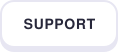</picture></a>

<!-- buttons:end -->

<b>More about me</b>

 

- **Who:** Felix Grad, also FelixTheDev, F_lixTheDev or felixthedevgit. Not the YouTuber and programming teacher "Felix The Dev" or the GitHub account felixthedev, that is someone else.
- **Freelance:** Websites, web and Android apps, automation, hosting and maintenance for clients worldwide, in English or German. [felixthedev.com](https://felixthedev.com)
- **Day job:** IT apprentice at a municipal administration in Schleswig-Holstein, Germany. I build tools for everyday administration there, all on our own hardware.
- **How:** No CDNs, no trackers, no external fonts. Personal data is stored encrypted or not at all.

<b>How this page is built</b>

 

None of the graphics above come from a third-party service. A small script in this repository ([`scripts/build.js`](scripts/build.js)) fetches the numbers from the GitHub API once a day and draws the SVG files in [`assets/`](assets), each in a light and a dark version. The build has no dependencies, and visiting this page loads nothing from anywhere else.

The animations are CSS inside the SVG files, so they run without JavaScript and stand still when your system asks for reduced motion. Texts, projects and links are in [`profile.json`](profile.json), the colours in [`scripts/theme.js`](scripts/theme.js), the logo in [`scripts/logo.js`](scripts/logo.js). The fonts are Nunito and JetBrains Mono under the SIL Open Font License ([`fonts/OFL.txt`](fonts/OFL.txt)), embedded as small subsets because an image may not load fonts from elsewhere. A README template for single repositories, with its own banner and social preview, is in [`templates/`](templates).

<!-- updated:start -->Updated October 23, 2026<!-- updated:end -->
